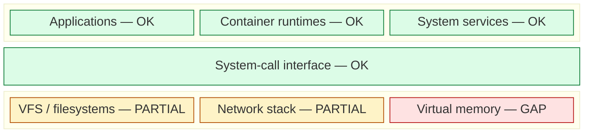

# Coverage map template

Implements [ADR 0001](../adr/0001-dynamic-mermaid-coverage-map.md). Layout concept:
Brendan Gregg's [Linux Performance diagrams](https://www.brendangregg.com/linuxperf.html) (original author; the observability map is the reference layout);
Mermaid `block-beta` approach per the [Mermaid block docs](https://mermaid.js.org/syntax/block.html).

## Inputs

- `coverage-architecture.yaml` – stable nodes, layers, instrumenting components.
- `coverage-status.json` – `node id -> OK | PARTIAL | GAP | UNKNOWN`.

## Generator rules

1. Emit one `block:<layer>:6` per layer with its `columns`; spanning nodes use `:6`.
2. Label each node `"<label> — <STATUS>"`.
3. Emit `class <ids> <class>` lines grouped by status
   (OK→`healthy`, PARTIAL→`degraded`, GAP→`missing`, UNKNOWN→`stale`).
4. Emit the component table: one row per node, each component as a repo-relative link.
5. Fail if a linked component path does not exist or a node has no status.
6. Replace content between `<!-- coverage-map:start -->` and `<!-- coverage-map:end -->` in `README.md`.

## Output skeleton

````markdown
<!-- coverage-map:start -->


| Area | Status | Instrumented by |
|---|---|---|
| Applications | OK | [docs/ai_agent_observability.md](./docs/ai_agent_observability.md) |
| System-call interface | OK | [falco-config.yaml](./falco-config.yaml), [falco_rules.local.yaml](./falco_rules.local.yaml) |
<!-- coverage-map:end -->
````

Legend: green = OK, amber = PARTIAL, red = GAP, gray = UNKNOWN.
